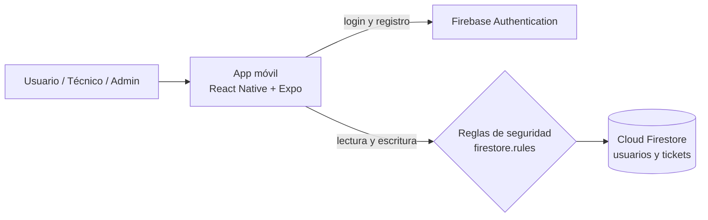
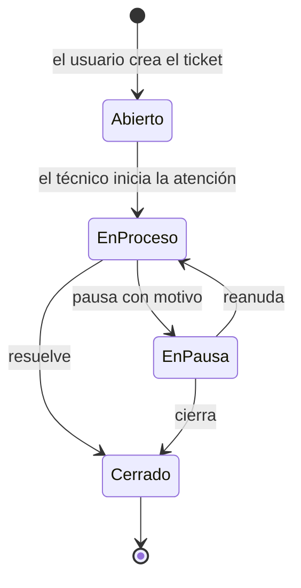
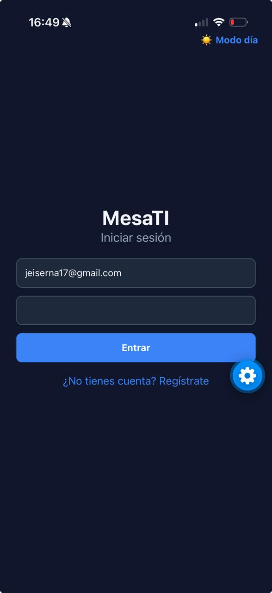
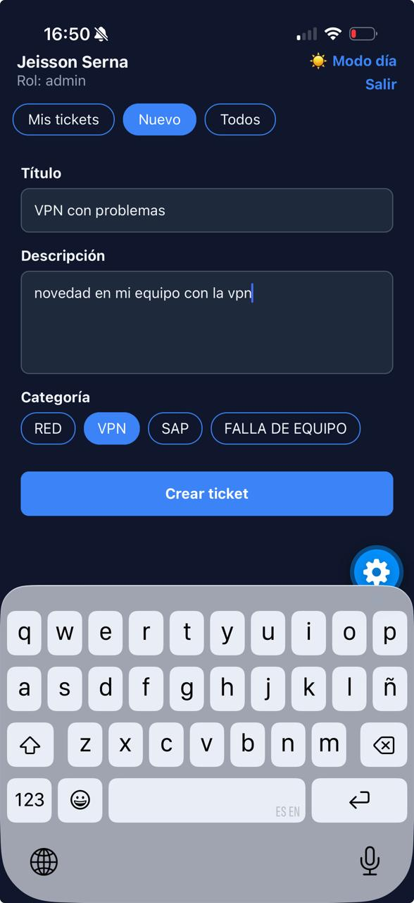
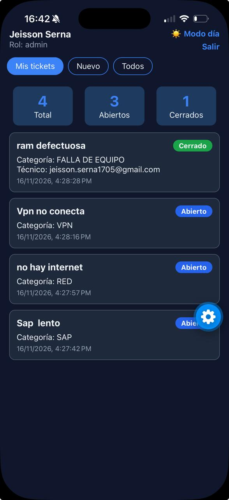
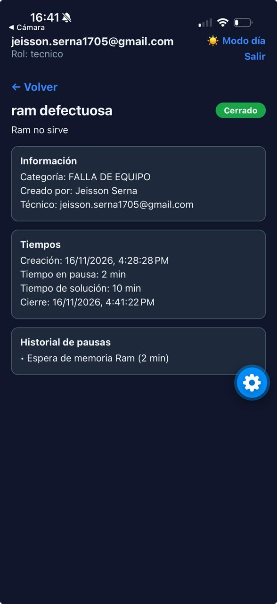
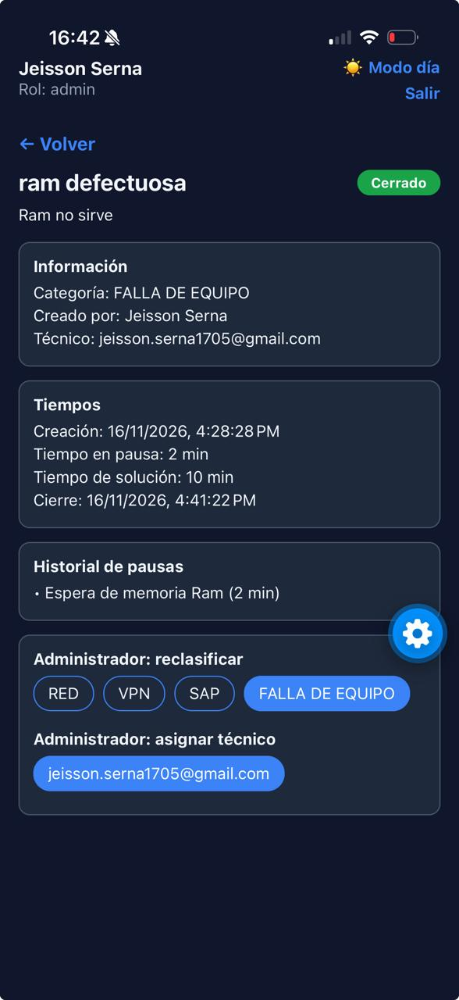
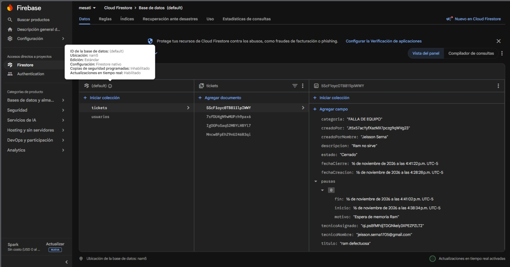

# MesaTI: gestión de tickets de soporte tecnológico

Aplicación móvil en la nube para reportar, asignar y dar seguimiento a incidencias de tecnología (red, VPN, SAP y fallas de equipo), midiendo cuánto tarda cada caso **sin contar el tiempo en pausa**.

**Autor:** Jeisson Serna
**Curso:** Diseño de Aplicaciones Móviles
**Actividad:** Taller ABP, Entrega 1: Proyecto, Presentación y Repositorio en GitHub

---

## 1. Problema

En muchas empresas los fallos de tecnología (red, VPN, SAP, equipos) se reportan por chat o por llamada. Esto genera tres problemas:

- No queda un registro ordenado de los casos.
- No se sabe quién atiende cada caso ni en qué estado está.
- No se puede medir cuánto tarda la solución. Cuando un caso queda detenido esperando un repuesto del proveedor, ese tiempo de espera se mezcla con el tiempo de trabajo real y los números dejan de ser útiles.

## 2. Solución propuesta

MesaTI es una app móvil de mesa de ayuda con:

- Tickets con categoría (RED, VPN, SAP, FALLA DE EQUIPO).
- Tres roles: usuario, técnico y administrador.
- El administrador puede **reclasificar** un ticket si cambia de categoría y **asignar un técnico**.
- Ciclo de vida del ticket con **pausas y su motivo** (por ejemplo, "esperando repuesto del proveedor").
- Cálculo automático del **tiempo de creación, tiempo en pausa y tiempo de solución** (descontando las pausas).
- Panel con el conteo de tickets: **total, abiertos y cerrados**.
- Modo día y modo noche.

### Roles

| Rol | Qué puede hacer |
|---|---|
| Usuario | Crear tickets y ver el estado de los suyos |
| Técnico | Ver los tickets que tiene asignados, iniciar atención, pausar con motivo, reanudar y cerrar |
| Administrador | Ver todos los tickets, reclasificar la categoría, asignar técnico y ver los conteos |

## 3. Tecnologías y por qué se eligieron

| Parte | Tecnología | Justificación |
|---|---|---|
| App móvil | React Native con Expo | Un solo código en JavaScript, se prueba en el celular con Expo Go sin instalar Android Studio ni Xcode |
| Autenticación | Firebase Authentication | Registro e inicio de sesión sin construir ni mantener un servidor |
| Base de datos | Cloud Firestore | Base de datos en la nube con actualización en tiempo real y reglas de seguridad por usuario |
| Seguridad | Firestore Security Rules | Cada rol solo puede leer y modificar lo que le corresponde |

Todo funciona dentro del plan gratuito de Firebase y no requiere servidor propio.

## 4. Arquitectura

Arquitectura de tres capas: presentación (la app), servicios en la nube y datos.



- La app **no tiene servidor propio**: se comunica directamente con Firebase.
- Las listas se actualizan solas en tiempo real (`onSnapshot`), sin recargar.
- Las reglas de seguridad se evalúan en la nube, antes de leer o escribir cualquier dato.

## 5. Ciclo de vida del ticket



Cada cambio guarda la hora en que ocurrió. Con esas horas se calculan los tiempos:

| Tiempo | Cómo se calcula |
|---|---|
| Creación | Hora en que se creó el ticket (la pone el servidor de Firebase) |
| Tiempo en pausa | Suma de cada pausa: hora de reanudar menos hora de pausar |
| Tiempo de solución | (Hora de cierre − hora de creación) − tiempo en pausa |

Un ticket se cuenta como **abierto** mientras no esté cerrado (incluye Abierto, En proceso y En pausa).

## 6. Modelo de datos (Firestore)

```
usuarios/{uid}
  nombre, correo, rol  (usuario | tecnico | admin)

tickets/{id}
  titulo, descripcion, categoria, estado
  creadoPor, creadoPorNombre
  tecnicoAsignado, tecnicoNombre
  fechaCreacion, fechaCierre
  pausas: [ { inicio, fin, motivo }, ... ]
```

Las pausas se guardan como lista dentro del ticket para evitar más colecciones y mantener el diseño simple. Para reclasificar, el administrador solo cambia el campo `categoria`.

## 7. Estructura del repositorio

```
mesati/
├── App.js                  # navegación, sesión y modo día/noche
├── src/
│   ├── firebase.js         # conexión con Firebase
│   ├── constantes.js       # categorías y estados
│   ├── tema.js             # colores de modo día y noche
│   ├── tiempos.js          # cálculo de tiempos (descuenta pausas)
│   ├── Boton.js            # botón reutilizable
│   ├── NuevoTicket.js      # crear ticket
│   ├── ListaTickets.js     # lista y conteos
│   └── DetalleTicket.js    # detalle, reclasificar, asignar, pausar, cerrar
├── docs/
│   └── capturas/           # capturas de la app
├── presentacion/           # diapositivas del proyecto
├── firestore.rules         # reglas de seguridad
├── .env.example            # plantilla de variables (sin claves reales)
└── package.json
```

## 8. Cómo ejecutarlo

Requisitos: Node.js (versión LTS), la app **Expo Go** en el celular y un proyecto de Firebase propio con Authentication (correo/contraseña) y Firestore activados.

```bash
git clone https://github.com/TU_USUARIO/mesati.git
cd mesati
npm install
```

1. Copia `.env.example` como `.env` y llena los valores con la configuración de tu app web de Firebase.
2. Inicia el proyecto:

```bash
npx expo start
```

3. Escanea el código QR con la cámara del celular (se abre en Expo Go). El computador y el celular deben estar en la misma red; si hay problemas, usa `npx expo start --tunnel`.

### Crear los roles

Todo usuario nuevo se registra con rol `usuario`. Para probar los demás roles:

1. Registra las cuentas desde la app.
2. En Firebase, abre **Firestore → usuarios → (documento de la cuenta)** y cambia el campo `rol` a `admin` o `tecnico`.
3. Cierra sesión y vuelve a entrar.

Dejar la asignación de roles en manos de la consola es intencional: impide que un usuario se otorgue permisos a sí mismo desde la app.

## 9. Seguridad y buenas prácticas

- Las claves de Firebase están en un archivo `.env` que **no se sube** a GitHub (`.gitignore`). Solo se publica `.env.example` con los nombres de las variables.
- Las variables `EXPO_PUBLIC_*` quedan incluidas en la app compilada, por lo que la protección real de los datos la dan las **reglas de Firestore** (`firestore.rules`) y no el ocultamiento de la clave.
- Reglas de seguridad por rol:
  - Un usuario solo lee los tickets que creó.
  - Un técnico solo lee y modifica los tickets que tiene asignados.
  - El administrador puede leer todo y gestionar los tickets.
  - Nadie puede borrar tickets ni cambiar su propio rol desde la app.
  - El ticket nuevo debe nacer con estado `Abierto` y a nombre de quien lo crea.
- Código separado por responsabilidad (pantallas, cálculo de tiempos, tema y conexión con la nube) y colores centralizados en un solo archivo.
- Commits ordenados por etapa de desarrollo.

## 10. Validación funcional

Se probó el flujo completo con las tres roles. Ejemplo real del ticket "ram defectuosa":

| Dato | Valor |
|---|---|
| Creación | 16/11/2026, 4:28:28 PM |
| Pausa | "Espera de memoria Ram", 2 min |
| Cierre | 16/11/2026, 4:41:22 PM |
| Tiempo total (cierre − creación) | 12 min 54 s |
| Tiempo en pausa | 2 min |
| **Tiempo de solución mostrado por la app** | **10 min** (el total sin la pausa) |

Conteos del panel durante la prueba: 4 tickets en total, 3 abiertos y 1 cerrado.

## 11. Capturas

| Login | Nuevo ticket | Lista y conteos |
|---|---|---|
|  |  |  |

| Detalle con tiempos | Vista del administrador | Datos en Firestore |
|---|---|---|
|  |  |  |

## 12. Rigor técnico y proyección investigativa

**Pregunta de investigación:** ¿cuánto cambia la medición del tiempo de solución de un incidente de TI cuando se descuentan las pausas por dependencias externas (por ejemplo, repuestos del proveedor) frente a medir solo de la creación al cierre?

**Idea central:** si se mide solo creación-cierre, el desempeño del técnico se ve peor de lo real cuando el caso depende de terceros. MesaTI registra cada pausa con su motivo, lo que permite separar el tiempo de trabajo del tiempo de espera y, a futuro, analizar cuáles motivos de pausa son los que más retrasan la atención.

**Limitaciones actuales:**

- El técnico asignado puede modificar cualquier campo de sus tickets (no solo el estado).
- Los roles se asignan manualmente desde la consola de Firebase.
- Los tiempos se calculan en la app, no en un servidor.

## 13. Trabajo futuro

- Métricas por categoría y por técnico (tiempo promedio de solución y de pausa).
- Metas de tiempo (SLA) por categoría, con alertas cuando un ticket se acerca al límite.
- Adjuntar fotos al ticket (Firebase Storage).
- Notificaciones push al asignar o cerrar un ticket.
- Pantalla de administración de usuarios para cambiar roles desde la app, con Cloud Functions.
- Reglas de seguridad más estrictas por campo.
